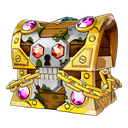
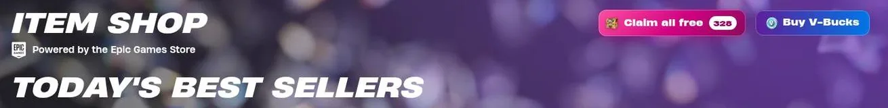
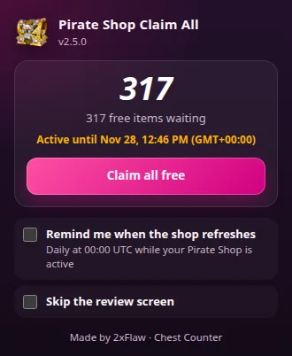
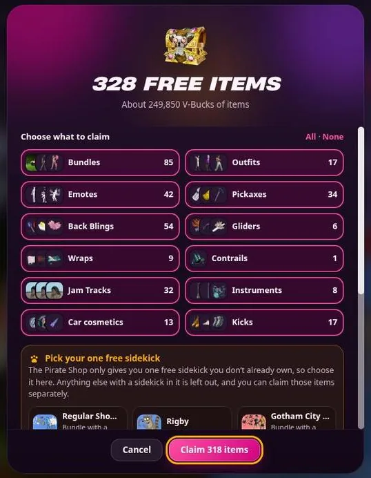
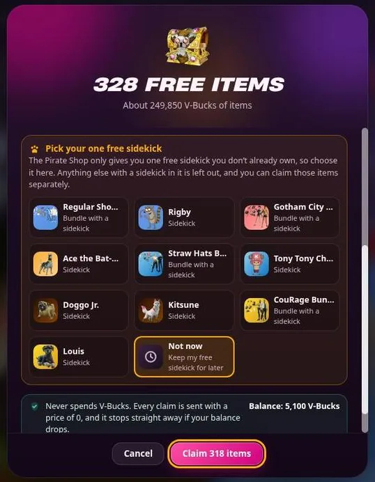
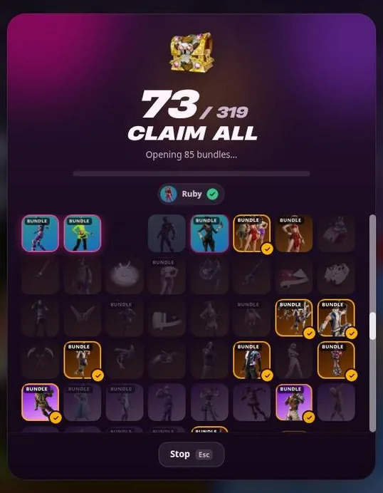
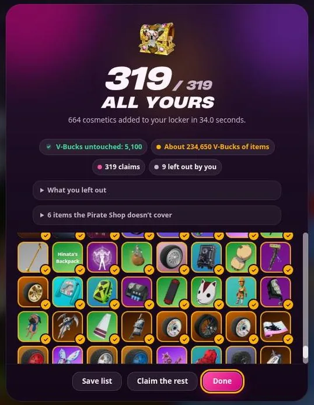

<p align="center">
  
</p>

<h1 align="center">Chest Counter: Pirate Shop Claim All</h1>

<p align="center">
  <b>Already own the Pirate Shop Access Token? Claim the whole Fortnite Item Shop with one button.</b><br>
  Free and open source. Never spends V-Bucks. By <a href="https://github.com/2xFlaw">2xFlaw</a>.
</p>

<p align="center">
  <a href="https://github.com/2xFlaw/ChestCounter/releases/latest/download/ChestCounter-ClaimAll-Chrome.zip"><b>Chrome / Edge / Brave / Opera</b></a> ·
  <a href="https://raw.githubusercontent.com/2xFlaw/ChestCounter/main/claim-all/dist/chest-counter-claim-all.user.js"><b>Firefox / Safari / other browsers</b></a> ·
  <a href="https://chestcounter.io/claim">chestcounter.io/claim</a> ·
  <a href="#faq">FAQ</a>
</p>

<p align="center">
  
</p>

The Pirate Shop Access Token makes everything sold for V-Bucks in the Fortnite Item Shop free for 14 days, but every item still has to be claimed one at a time. Claim All adds a **Claim all free** button next to **Buy V-Bucks** on [fortnite.com/item-shop](https://www.fortnite.com/item-shop), lets you choose what you want, and claims it all for you. A full shop of 300+ items takes about 30 to 60 seconds.

> [!IMPORTANT]
> You have to **activate** the Pirate Shop in game first. Owning the token isn't enough: if the web shop shows **Plunder the Shop!**, it hasn't been activated yet.
>
> Epic's rules: while the Pirate Shop is active, items sold for V-Bucks are free to claim for 14 days from the moment you activate it. Real-money offers, gifting and pass levels or rewards are excluded, and you can only claim **one** free sidekick you don't already own. You can activate it once in 2026 and once in 2027, and it isn't transferable. **The 2026 Pirate Shop must be activated by Dec 16, 12 AM (GMT+00:00).**

## Install

### Chrome, Edge, Brave, Opera and other Chromium browsers
1. Download **[ChestCounter-ClaimAll-Chrome.zip](https://github.com/2xFlaw/ChestCounter/releases/latest/download/ChestCounter-ClaimAll-Chrome.zip)** and unzip it (right-click > Extract All). Keep the folder somewhere you won't delete it.
2. Open `chrome://extensions` (Edge: `edge://extensions`, Brave: `brave://extensions`, Opera: `opera://extensions`).
3. Turn on **Developer mode**.
4. Click **Load unpacked** and pick the unzipped folder (the one with `manifest.json` in it).
5. Pin the pirate chest icon to your toolbar so you can see how many free items are waiting.

<p align="center"></p>

### Firefox, Safari and everything else (userscript)
1. Install a userscript manager:
   - Firefox: [Violentmonkey](https://addons.mozilla.org/firefox/addon/violentmonkey/) or [Tampermonkey](https://addons.mozilla.org/firefox/addon/tampermonkey/)
   - Safari (Mac, iPhone, iPad): [Userscripts](https://apps.apple.com/app/userscripts/id1463298887) (free). After installing, turn it on in Safari's extension settings and allow it on fortnite.com
   - Chrome and Edge also work with Violentmonkey or Tampermonkey if you prefer a userscript over the extension
2. Open **[chest-counter-claim-all.user.js](https://raw.githubusercontent.com/2xFlaw/ChestCounter/main/claim-all/dist/chest-counter-claim-all.user.js)** and click **Install** when your manager asks.

Use one or the other, not both at once. If both are installed, only the first one to load adds the button.

## How to use
1. Activate the Pirate Shop in the in-game Item Shop.
2. Sign in at [fortnite.com/item-shop](https://www.fortnite.com/item-shop) with the same account.
3. Click **Claim all free** next to Buy V-Bucks (or the toolbar icon, then **Claim all free**).
4. Pick the categories you want and your one free sidekick, then press **Claim**.
5. Watch the progress. Press **Stop** or **Esc** whenever you like.
6. When it's done, press **Done**. The page reloads and everything shows as owned.

<p align="center">
  
  
</p>
<p align="center">
  
  
</p>

## What's new compared to the original
Claim All is based on [Napzeee's Pirate Token Claim All](https://github.com/Napzeee/fortnite-pirate-token-claim-all-extension) (MIT) and uses the same claim requests. On top of that it adds:

- **Review screen.** See how many items and how many V-Bucks they're worth, then choose categories (Bundles, Outfits, Emotes, Pickaxes, Back Blings, Gliders, Wraps, Contrails, Jam Tracks, Instruments, Car cosmetics, Kicks) before anything is claimed. You can skip it next time if you want one-click claiming.
- **Sidekick picker.** Epic only gives you one free sidekick, so you pick it yourself (or keep it for later). Everything else that includes a sidekick is left out, so the free one isn't used up by accident.
- **Safety stop.** Your V-Bucks balance is checked before the run, during it and after it. If it ever drops, claiming stops straight away.
- **Handles Epic's rate limits.** When Epic says "slow down", it backs off, halves its speed and carries on instead of failing.
- **Retry and Claim the rest.** Anything that failed or was stopped can be retried with one click.
- **Clear results.** Totals, the V-Bucks value of what you got, what came with bundles, what you left out and what the Pirate Shop doesn't cover (real-money packs and Epic's excluded items).
- **Save list.** Download a text list of everything you claimed.
- **Toolbar badge and daily reminder** (extension). The icon shows how many free items are waiting, and you can turn on a reminder when the shop refreshes at 00:00 UTC while your Pirate Shop is active.
- **Lifetime stats** in the popup: items claimed and V-Bucks worth.
- **10 languages.** English, Español, Português, Русский, Français, Deutsch, Italiano, Polski, Türkçe and 日本語, following the language you pick on fortnite.com.
- **A version for every browser.** The userscript works in Firefox, Safari and anything else with a userscript manager.
- **Demo mode** to try it without claiming anything (below).

## Demo mode
Add `?ccdemo=1` to the address, for example [fortnite.com/item-shop?ccdemo=1](https://www.fortnite.com/item-shop?ccdemo=1). You get the whole flow with today's real shop, but **nothing is sent to Epic**. A yellow "Demo" badge is shown the whole time. It works even without the token, so it's a good way to see what you'd get before activating.

## Updating
- **Extension:** when a new version is out, the popup shows a banner. Download the new zip, unzip it over the old folder, then press the reload button on the extension card in `chrome://extensions`.
- **Userscript:** your userscript manager updates it automatically.

## Safety
- Claims use the same request as Epic's own Confirm button, always with an expected price of **0**. Epic's servers reject any claim for an item that isn't actually free, so it can't spend V-Bucks.
- Your balance is checked before, during and after every run, and it stops if the balance goes down.
- Everything runs in your browser on fortnite.com. Nothing is sent anywhere else, there are no analytics, and it never sees your password.
- The only other request is the extension popup checking [version.json](version.json) on GitHub for updates.
- It only runs on `https://www.fortnite.com/*`.

## FAQ
**Is this a mod or a cheat?**
No. It's a browser extension or userscript that only runs on fortnite.com. It never touches the game or files on your PC. It does the same thing as clicking Claim on every item yourself, just faster.

**It says the Pirate Shop isn't active.**
Activate it in the in-game Item Shop first. The website shows **Plunder the Shop!** until you do. Activating starts the 14-day clock.

**Can I get every sidekick?**
No. Epic only lets you claim one free sidekick you don't already own. The picker lets you choose which one. Bundles that contain a sidekick count as your sidekick.

**Some items were skipped.**
Open "Why some were skipped" on the finished screen. Usually they already came with a bundle, Epic asked us to slow down (press Retry in a minute), or an item isn't free under the Pirate Shop.

**The shop changed. Can I claim again?**
Yes. The shop refreshes at 00:00 UTC, and you can claim the new items every day for 14 days.

**Does it work on mobile or console?**
The extension needs desktop Chrome, Edge, Brave or Opera. The userscript works in Safari on iPhone and iPad with the Userscripts app. Items show up on every platform you play on.

**Why isn't it on the Chrome Web Store?**
Loading it unpacked means you can read every line of the code you're running. A store listing may follow.

## Building from source
```
node claim-all/build.mjs
```
This builds `dist/chrome/` (load it with Load unpacked), `dist/ChestCounter-ClaimAll-Chrome.zip` and `dist/chest-counter-claim-all.user.js` from [`src`](src) and [`extension`](extension). Node 18 or newer, no dependencies.

## Credits and license
Chest Counter Claim All was made by [2xFlaw](https://github.com/2xFlaw), who came up with the idea and wrote this version: the review screen, sidekick picker, safety stop, retry, saved list, demo mode, toolbar button, userscript and translations.

It builds on [Pirate Token Claim All](https://github.com/Napzeee/fortnite-pirate-token-claim-all-extension) by Napzeee, whose claim requests it uses. Thanks to Napzeee for the original.

Released under the [MIT License](LICENSE). Use at your own risk.

---
Not affiliated with or endorsed by Epic Games. Fortnite and the Pirate Shop artwork are trademarks and property of Epic Games, Inc.
